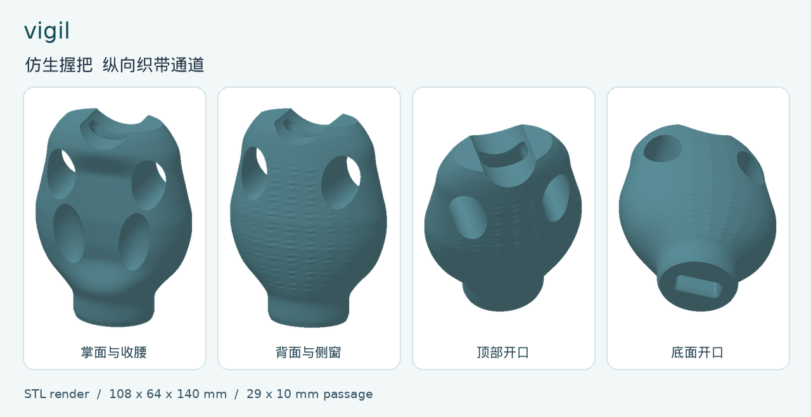
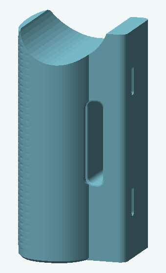
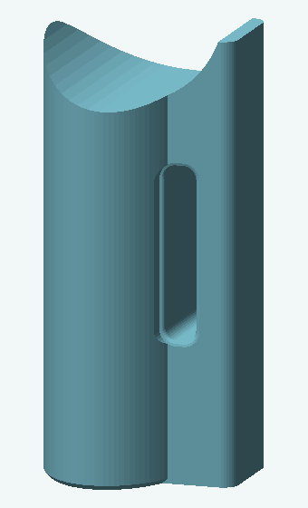
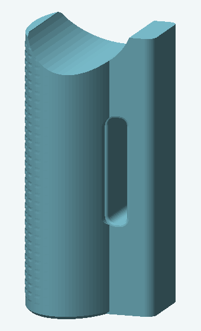
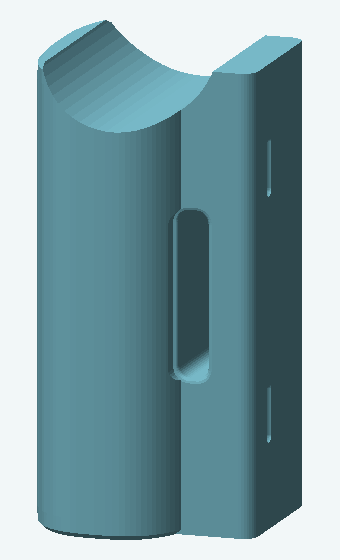
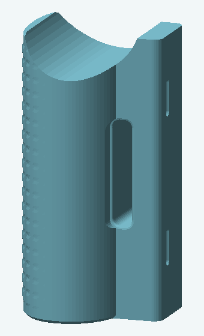
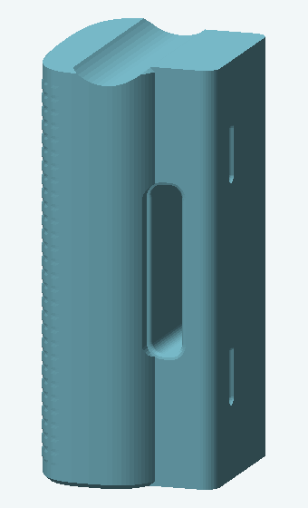

# Vigil-Arm

开源 3D 打印腕力训练器械，用 OpenSCAD 编写，单位是毫米。仓库里有一件仿生握把，以及文件夹 03–09 的七件指屈把手。图纸第 3 页的 02 号圆筒握套没有源文件。

Open-source grip and wrist trainer, written in OpenSCAD, in millimetres. The repository holds one anatomical grip and seven finger-flexor handles in folders 03–09. Cylindrical sleeve 02 is on page 3 of the drawings and has no source file in this repository.

中文开发说明是 [vigil.md](vigil.md)，英文是 [vigil.en.md](vigil.en.md)。

Development notes: [vigil.md](vigil.md) in Chinese, [vigil.en.md](vigil.en.md) in English.

## 安全 / Safety

这些零件没有实物载荷测试。它们不是医疗器械，也不能代替教练或医务人员的指导。仓库里没有承载额定值。[夹具载荷记录](docs/load-test-record.md) 是一张空表，试验载荷和通过标准留待按实际使用条件填写。

These parts have no physical load test. They are not medical devices, and they do not replace a coach or a clinician. This repository states no load rating. The [fixture load-test record](docs/load-test-record.md) is a blank sheet. The test load and the pass criteria are filled in from the real conditions of use.

**每次使用前先看整件打印品。** 孔口、侧窗周围和腰部一起看。有裂纹、层与层分开、发白、边缘压溃，或孔道已经走形，就不要使用。层纹是打印的分层方向，开裂常常沿着层纹出现。织带、弹力带和连接件按各自制造商的说明同时检查。

**Look over the whole print before each use.** Include the openings, the material beside the side windows, and the waist. Set the part aside if you see a crack, layers coming apart, whitening, a crushed edge, or a passage that has gone out of shape. Cracks in an FDM print often follow the layer lines. Check the webbing, the resistance band, and the connectors by their own manufacturers' instructions at the same time.

- **逐步加载。** 从明显低于预定训练拉力的载荷开始。只有在没有新裂纹、没有层间分离、卸力后也没有留下变形时，才提高载荷。某一次没有坏，仍然不是额定值。
- **疼痛就停。** 疼痛是结束这一组的理由。
- **远离高温。** 不要放在暴晒处、闷热车厢、暖气或热水附近。常见的 FDM 塑料受热会变软，并在受力时缓慢变形。不要在偏热的地方让带子一直拉着零件存放。
- **定期更换。** 本仓库没有使用寿命。检查中一旦看到裂纹、层裂、发白，或卸力后仍在的变形，就停用并更换。
- **躲开回弹。** 按弹力带制造商允许的方式连接。不要把脸放在张紧带子的延长线上。说明见下方参考链接。

- **Load up in steps.** Start well below the pull you mean to train with. Raise it only while the print shows no new crack, no split between layers, and no set that remains after you unload. Surviving one pull does not create a rating.
- **Stop on pain.** Pain is a reason to end the set.
- **Keep the parts away from heat.** That includes direct sun, a closed hot car, a heater, and hot water. Ordinary FDM plastics soften when they are warm and creep while a load is on them. Do not store a print in a warm place with a band still pulling on it.
- **Replace the part periodically.** This repository states no service life. Retire and replace the print as soon as an inspection finds a crack, a layer split, whitening, or a bend that stays after the load comes off.
- **Stay out of a snap-back.** Connect the band in a way its manufacturer allows. Keep your face off the line of a stretched band. The reference below is the one already cited in the development notes.

## 模型 / Models

**仿生握把 / Anatomical grip**（仓库根目录）。用于屈腕和包指时抵抗向外拉开的力。握身保留掌腹、双肩、掌凹、侧窗、背部纹理和收腰，外包络 **108 × 64 × 140 mm**。纵向通道从顶部凹口通到底面，最窄截面 **29 × 10 mm**，平面圆角 R2，两端最多扩到 **33 × 14 mm**。通道按 **25 mm** 宽、穿孔部分（含缝合）总厚不超过 **6 mm** 的成品织带设计。弹力带在握把外面接到织带上。侧窗中心距底面 **105 mm**，窗的名义尺寸是 **22 × 34 mm**。侧窗旁采样到的径向余量约 **5.5 mm**，实物受力时要看这里。

**Anatomical grip** (repository root). A contoured handle for wrist flexion and finger containment against an outward pull. It keeps the palm swell, shoulders, palm hollow, side windows, back texture, and tapered waist, in an envelope of **108 × 64 × 140 mm**. A longitudinal channel runs from the top recess out through the bottom face. The narrowest section is **29 × 10 mm**, with a 2 mm fillet in plan, flaring at the ends to at most **33 × 14 mm**. The channel is sized for finished webbing **25 mm** wide and at most **6 mm** thick at the pass-through, stitching included. The resistance band attaches to that webbing outside the grip. The side-window center is **105 mm** from the bottom, and the nominal window is **22 × 34 mm**. The sampled radial margin beside the side window is about **5.5 mm**. Watch that region under a real load.

**指屈把手 / Finger-flexor grips**（03–09）。手指握住前面的握面，弹力带从背侧横梁的左右贯通槽穿过，一侧进入、另一侧出来。净孔 **44 × 8 mm**，长边沿高度，两端渐扩。设计输入是带宽 **26–40 mm**、穿孔总厚不超过 **6 mm**。折叠处按叠起来的总厚度量，较厚的端头单独量。各件保留自己的握面、顶口和外包络，差别在尺寸、顶口深度和握面纹理。几何写在共用的 [finger_flexor.scad](finger_flexor.scad) 里，各文件夹的 `vigil.scad` 只选择款式。

**Finger-flexor grips** (03–09). The fingers close on the front face, and a resistance band passes through a side-to-side slot in the rear rail, in one side and out the other. The clear opening is **44 × 8 mm**, long side along the grip height, with a flare at each end. The design input is a band **26–40 mm** wide and at most **6 mm** thick at the pass-through. Measure a fold as a stack, and measure a thicker end on its own. Each variant keeps its own grip face, top recess, and envelope. They differ in size, recess depth, and face texture. All seven geometries live in [finger_flexor.scad](finger_flexor.scad). Each folder's `vigil.scad` only selects the variant.

- **03 宽体双肩 / Wide dual-shoulder.** 七件里较宽的双肩握把，握面细网格。图纸外包络 68 × 62.3 × 123 mm。
- **04 窄体双肩 / Narrow dual-shoulder.** 七件里最小，握面光滑。外包络 53 × 52 × 113 mm。
- **05 圆弧握把 / Curved grip.** 握面细网格。图纸外包络 64 × 58.3 × 117 mm。
- **06 侧脊握把 / Side-ridge grip.** 握面竖向纹理。图纸外包络 68 × 61.3 × 123 mm。
- **07 方格握把 / Grid-textured grip.** 握面粗网格。图纸外包络 65 × 61.6 × 118 mm。
- **08 横纹握把 / Cross-ribbed grip.** 握面横向肋。图纸外包络 68 × 64.4 × 120 mm。源码里这件横梁圆角是 2.4 mm，其余指屈把手是 4 mm。
- **09 浅口握把 / Shallow-notch grip.** 顶部凹口深 4 mm，其余指屈把手是 14–17 mm。握面细网格。图纸外包络 60 × 49.4 × 110 mm。

- **03 Wide dual-shoulder.** The broader of the shouldered grips, with a fine grid on the face. Drawing envelope 68 × 62.3 × 123 mm.
- **04 Narrow dual-shoulder.** The smallest of the seven, with a smooth face. Envelope 53 × 52 × 113 mm.
- **05 Curved grip.** Fine grid on the face. Drawing envelope 64 × 58.3 × 117 mm.
- **06 Side-ridge grip.** Vertical texture on the face. Drawing envelope 68 × 61.3 × 123 mm.
- **07 Grid-textured grip.** Coarse grid on the face. Drawing envelope 65 × 61.6 × 118 mm.
- **08 Cross-ribbed grip.** Horizontal ribs on the face. Drawing envelope 68 × 64.4 × 120 mm. In the source this rail corner is 2.4 mm. The other finger-flexor grips use 4 mm.
- **09 Shallow-notch grip.** The top recess is 4 mm deep. The other finger-flexor grips use 14–17 mm. Fine grid on the face. Drawing envelope 60 × 49.4 × 110 mm.

纹理使部分图纸深度比源码里的名义握身大约 0.3–0.6 mm。名义宽、深、高写在 `finger_flexor.scad` 的预设里。04 号没有纹理，图纸尺寸和名义握身相同。

Texture makes some drawing depths about 0.3–0.6 mm larger than the nominal body in the source. Nominal width, depth, and height are the presets in `finger_flexor.scad`. Folder 04 is smooth, so the drawing envelope and the nominal body match.

**02 圆筒握套 / Cylindrical sleeve 02.** 只出现在 [vigil.pdf](vigil.pdf) 第 3 页：外包络 61.1 × 61.1 × 105 mm，通孔直径 44 mm、长 105 mm，凸纹外径约 61.1 mm。图纸写的文件名是 `02/vigil.stl` 和 `02/vigil.scad`。这个仓库里没有这两份文件，`finger_flexor.scad` 也不生成这件模型。

**Cylindrical sleeve 02.** It appears only on page 3 of [vigil.pdf](vigil.pdf): envelope 61.1 × 61.1 × 105 mm, through-hole diameter 44 mm, hole length 105 mm, ribbed outside diameter about 61.1 mm. The drawing names `02/vigil.stl` and `02/vigil.scad`. Neither file is in this repository, and `finger_flexor.scad` does not build this model.

## 文件夹 / Folder map

文件夹编号比旧预设名大 2，因为 02 号是另一件模型。03 是原来的 `grip_01`，一直到 09 是 `grip_07`。现在的变体名是 `folder_03` … `folder_09`。

Folder numbers are two ahead of the old preset names, because sleeve 02 is a different model. Folder 03 was `grip_01`, through folder 09 as `grip_07`. The variant ids now are `folder_03` … `folder_09`.

每件模型的源码、STL 和预览都叫 `vigil.scad`、`vigil.stl`、`vigil.png`。仿生握把的三份文件在仓库根目录，指屈把手的在对应编号文件夹里。

Every model uses the same file names: `vigil.scad`, `vigil.stl`, and `vigil.png`. The anatomical grip's three files are in the repository root. Each finger-flexor grip's three files are in its numbered folder.

| 文件夹 / Folder | 变体 / Variant | 旧预设 / Old preset | 模型 / Model | 图纸外包络 / Drawing envelope (mm) | 文件 / Files |
| --- | --- | --- | --- | --- | --- |
| （根目录）/ root | `vigil.scad` | — | 仿生握把 / Anatomical grip | 108 × 64 × 140 | [scad](vigil.scad) · [stl](vigil.stl) · [png](vigil.png) |
| 02 | — | — | 圆筒握套 / Cylindrical sleeve | 61.1 × 61.1 × 105，仅图纸 / drawing only | 仓库中无源文件 / no source in this repo |
| 03 | `folder_03` | `grip_01` | 宽体双肩 / Wide dual-shoulder | 68 × 62.3 × 123 | [scad](03/vigil.scad) · [stl](03/vigil.stl) · [png](03/vigil.png) |
| 04 | `folder_04` | `grip_02` | 窄体双肩 / Narrow dual-shoulder | 53 × 52 × 113 | [scad](04/vigil.scad) · [stl](04/vigil.stl) · [png](04/vigil.png) |
| 05 | `folder_05` | `grip_03` | 圆弧握把 / Curved grip | 64 × 58.3 × 117 | [scad](05/vigil.scad) · [stl](05/vigil.stl) · [png](05/vigil.png) |
| 06 | `folder_06` | `grip_04` | 侧脊握把 / Side-ridge grip | 68 × 61.3 × 123 | [scad](06/vigil.scad) · [stl](06/vigil.stl) · [png](06/vigil.png) |
| 07 | `folder_07` | `grip_05` | 方格握把 / Grid-textured grip | 65 × 61.6 × 118 | [scad](07/vigil.scad) · [stl](07/vigil.stl) · [png](07/vigil.png) |
| 08 | `folder_08` | `grip_06` | 横纹握把 / Cross-ribbed grip | 68 × 64.4 × 120 | [scad](08/vigil.scad) · [stl](08/vigil.stl) · [png](08/vigil.png) |
| 09 | `folder_09` | `grip_07` | 浅口握把 / Shallow-notch grip | 60 × 49.4 × 110 | [scad](09/vigil.scad) · [stl](09/vigil.stl) · [png](09/vigil.png) |

指屈把手的槽孔中心高度，从底面量起，见图纸第 6 页：03 为 63.3 mm，04 为 58.2 mm，05 为 60.3 mm，06 为 63.3 mm，07 为 60.8 mm，08 为 61.8 mm，09 为 56.6 mm。

Slot-center height of each finger-flexor grip, measured from the bottom, is on page 6 of the drawings: 03 is 63.3 mm, 04 is 58.2 mm, 05 is 60.3 mm, 06 is 63.3 mm, 07 is 60.8 mm, 08 is 61.8 mm, and 09 is 56.6 mm.

## 预览 / Previews

仿生握把的预览是根目录的 `vigil.png`，四张视图来自现有的 STL 渲染图。03–09 的预览都叫 `vigil.png`，画布都是 340 × 560，背景和配色与这张总图一致，几何仍是各文件夹里原有的渲染。

The anatomical preview is `vigil.png` in the repository root, the existing four-view STL render. Previews for 03–09 use the same file name, `vigil.png`, on one 340 × 560 canvas, with the same background and material color as that sheet. The geometry in each image is the render that was already in that folder.



| 03 宽体双肩 / Wide dual-shoulder | 04 窄体双肩 / Narrow dual-shoulder | 05 圆弧 / Curved | 06 侧脊 / Side-ridge |
| --- | --- | --- | --- |
|  |  |  |  |

| 07 方格 / Grid-textured | 08 横纹 / Cross-ribbed | 09 浅口 / Shallow-notch |
| --- | --- | --- |
|  |  |  |

## 重新导出与检查 / Rebuild and check

在仓库根目录：

From the repository root:

```sh
python3 -m pip install -r checks/requirements.txt
./scripts/check.sh
```

`./scripts/check.sh` 用 OpenSCAD 的 `--backend CGAL` 重新导出每一件 STL，再核对水密网格、[checks/expected.json](checks/expected.json) 里的外包络、织带或弹力带通道，以及新导出的网格和已提交 STL 的偏差。CI 在 [.github/workflows/geometry.yml](.github/workflows/geometry.yml) 里安装 OpenSCAD **2026.11.10** 快照后运行同一条命令。二进制不在 `PATH` 上时，用 `OPENSCAD` 指向它。

`./scripts/check.sh` re-exports every STL with OpenSCAD's `--backend CGAL`, then checks the watertight mesh, the envelope in [checks/expected.json](checks/expected.json), the webbing or band passage, and the drift between that export and the committed STL. CI runs the same command after installing the OpenSCAD **2026.11.10** snapshot, in [.github/workflows/geometry.yml](.github/workflows/geometry.yml). If the binary is not on `PATH`, point `OPENSCAD` at it.

要和仓库里的 STL 一致，手动导出也要加上 CGAL。默认的 Manifold 后端得不到这些网格。

A hand export has to pass CGAL as well if it is meant to match the STL in git. The default Manifold backend does not reproduce these meshes.

```sh
openscad --backend CGAL --hardwarnings --export-format binstl -o vigil.stl vigil.scad
openscad --backend CGAL --hardwarnings --export-format binstl -o 03/vigil.stl 03/vigil.scad
```

其余指屈把手把命令里的 `03` 换成 `04` 到 `09`。几何改动后重新跑 `./scripts/check.sh`。

For another finger-flexor grip, swap the folder in that command for `04` through `09`. After a geometry change, run `./scripts/check.sh` again.

## 建议的打印设置 / Recommended print settings

本节里的喷嘴、层高、壁线、填充和材料是建议起点，依据是模型里已经写明的尺寸，以及普通 FDM 打印的习惯。**这些数值没有在 Vigil-Arm 的打印件上测试过，也不是承载能力。** 打印机、材料牌号、喷嘴、壁线、填充、打印方向和预定最大拉力，写进空的 [载荷记录](docs/load-test-record.md)。

The nozzle, layer height, walls, infill, and material below are a recommended starting point. They come from dimensions the models already state, and from ordinary FDM practice. **These values have not been tested on a printed Vigil-Arm part, and they are not a load capacity.** Write the printer, material grade, nozzle, wall lines, infill, print orientation, and the planned maximum pull on the blank [load-test record](docs/load-test-record.md).

开发说明里已经确定的打印步骤：

The print steps already set in the development notes:

1. 以毫米、100% 比例导入 STL。仿生握把按模型的直立方向打印，140 mm 的高度和纵向通道沿打印机的 Z 轴。切片时看侧窗顶部、孔道和两端开口，并安排能够拆除的支撑。
2. 指屈把手也按高度沿 Z 的方向打印。净孔是高度方向 44 mm、深度方向 8 mm。切片时查看横孔顶部的桥接或支撑，孔内的支撑必须能从两端取出。装带子之前清掉毛刺和残留支撑。
3. 空载时测量实际织带或弹力带，包括缝合、折叠和较厚的端头，并检查侧窗边缘、外回程、接头和手指之间的空隙。
4. 完整装配先在夹具上按真实拉力方向做无人握持的加载。试验载荷和通过标准由使用条件决定，不在本仓库里。

1. Import the STL in millimetres at 100% scale. Print the anatomical grip in the model's upright orientation, so the 140 mm height and the longitudinal channel follow the printer's Z axis. In the slicer, inspect the side-window crowns, the channel, and both mouths, and arrange support that can be removed.
2. Print each finger-flexor grip with its height along Z as well. The clear opening is 44 mm along the height and 8 mm along the depth. In the slicer, check bridging or support at the crown of that transverse slot, and confirm that any support inside the slot can be cleared from both ends. Remove burrs and leftover support before a band goes in.
3. Unloaded, measure the real webbing or band, including stitching, folds, and thick ends, and check the clearance between the side-window edges, the outer return, the connectors, and the fingers.
4. Test the complete assembly on a fixture, along the real pull direction, before anyone holds it. The test load and the pass criteria come from the conditions of use. They are not in this repository.

建议起点，未测试：

Recommended starting point, untested:

| 项目 / Item | 建议 / Recommendation |
| --- | --- |
| 喷嘴 / Nozzle | 0.4 mm。29 × 10 mm 的通道和 44 × 8 mm 的槽都远大于这个喷嘴。/ A 0.4 mm nozzle. The 29 × 10 mm channel and the 44 × 8 mm slot are both much larger than that nozzle. |
| 层高 / Layer height | 0.20 mm。这是功能件上常见的层高。/ 0.20 mm, a usual functional layer height. |
| 壁线 / Walls | 约 6 层周线。0.4 mm 喷嘴的挤出宽度常见约为 0.45 mm，六层每侧约 2.7 mm，可以把仿生握把侧窗旁约 5.5 mm 的余量打成壁而不是稀疏填充。挤出宽度以切片器为准，在预览里确认。指屈把手用同样的壁线数，并确认槽边不止一条周线。/ About six perimeters. A 0.4 mm nozzle is often given an extrusion width near 0.45 mm, so six perimeters are about 2.7 mm each side and can fill the anatomical grip's ~5.5 mm margin beside the side windows with wall rather than sparse infill. The slicer owns the extrusion width; confirm it in the preview. Use the same wall count on the finger-flexor grips, and confirm that the slot edge is more than a single perimeter. |
| 顶底实心层 / Top and bottom shells | 0.20 mm 层高下 5 层，大约 1.0 mm 实心皮。通道和槽会打断顶面和底面。/ Five layers at 0.20 mm, about 1.0 mm of solid skin. The channel and the slot interrupt the top and the bottom. |
| 填充 / Infill | 20–40% 的 gyroid，作为把手的常见起点。通道、侧窗和槽周围的壁，比把芯部打得更密更要紧。/ 20–40% gyroid, a common starting point for a handle. Walls around the channel, the side windows, and the slot matter more than a denser core. |
| 支撑 / Support | 仿生握把：按说明检查侧窗顶部和两端开口，悬空处加可拆除的支撑。指屈把手：在切片里看槽顶；落在孔内的支撑必须从两端抽出。/ Anatomical grip: check the side-window crowns and both mouths, as the notes already ask, and add removable support where the slice shows an overhang. Finger-flexor grips: inspect the slot crown in the slice. Support that lands inside the slot has to come out of both ends. |
| 首层 / First layer | 仿生握把恢复了收腰，落在热床上的底面较窄，加一圈 brim 是合理的首层辅助。拆掉 brim，保持底面开口通畅。/ The anatomical grip's restored waist is narrow on the bed. A brim is a reasonable first-layer aid. Remove it so the bottom opening stays clear. |
| 材料 / Material | 仓库没有指定塑料，也没有材料测试。把手会待在室温里并反复受弯，通常的 FDM 建议是 PETG 或同类的韧性共聚酯。按耗材商的温度、风扇和干燥说明打印。PLA 更容易打，软化温度也更低；如果使用 PLA，上面的远离高温就是要守住的界限。尼龙一类会吸湿的材料打印后尺寸会变，吸湿稳定后再量孔。仿生通道是 29 × 10 mm，对应 25 mm 宽、最厚 6 mm 的织带。指屈槽是 44 × 8 mm，对应最宽 40 mm、最厚 6 mm 的带子。这是配合间隙，不是剩余强度。/ The repository names no polymer and reports no material test. For a handle that sits at room temperature and sees repeated bending, the usual FDM suggestion is PETG or a similar tough copolyester. Print to the filament maker's temperature, fan, and drying notes. PLA is easier to print and softens at a lower temperature. If you print PLA, the heat warning above is the limit to keep. Nylon and other materials that take up moisture can change size after printing, so measure the opening once that movement has settled. The anatomical channel is 29 × 10 mm for webbing 25 mm wide and up to 6 mm thick. The finger slot is 44 × 8 mm for a band up to 40 mm wide and 6 mm thick. Those are fit clearances, not leftover strength. |

参考 / References: [打印方向与结构件设计 / Print orientation and structural parts](https://help.prusa3d.com/article/modeling-with-3d-printing-in-mind_164135) · [弹力带检查与连接 / Checking and connecting a resistance band](https://abuhb.nhs.wales/files/patient-information-leaflets1/physiotherapy/safety-advice-when-exercising-with-resistance-bands-or-tubing-piu1332/)

## 说明与记录 / Notes and records

| 文件 / File | 内容 / Contents |
| --- | --- |
| [vigil.md](vigil.md) | 中文开发说明：造型、走带、打印与几何检查 / Chinese development notes: shape, strap path, printing, and the geometry check |
| [vigil.en.md](vigil.en.md) | 同一份说明的英文 / The same notes in English |
| [vigil.pdf](vigil.pdf) | 图纸，共 6 页。第 3 页含没有源文件的 02 号圆筒握套 / Drawings, 6 pages. Page 3 includes cylindrical sleeve 02, which has no source here |
| [vigil.scad](vigil.scad) | 仿生握把参数 / Anatomical grip parameters |
| [finger_flexor.scad](finger_flexor.scad) | 03–09 的共用几何 / Shared geometry for 03–09 |
| [docs/load-test-record.md](docs/load-test-record.md) | 空白夹具载荷记录 / Blank fixture load-test record |
| [docs/load-test-record.csv](docs/load-test-record.csv) | 同一张表的表头，没有数据行 / The same columns as a header, with no data rows |
| [checks/expected.json](checks/expected.json) | 几何检查使用的预期尺寸 / Envelopes and passages the geometry check expects |
