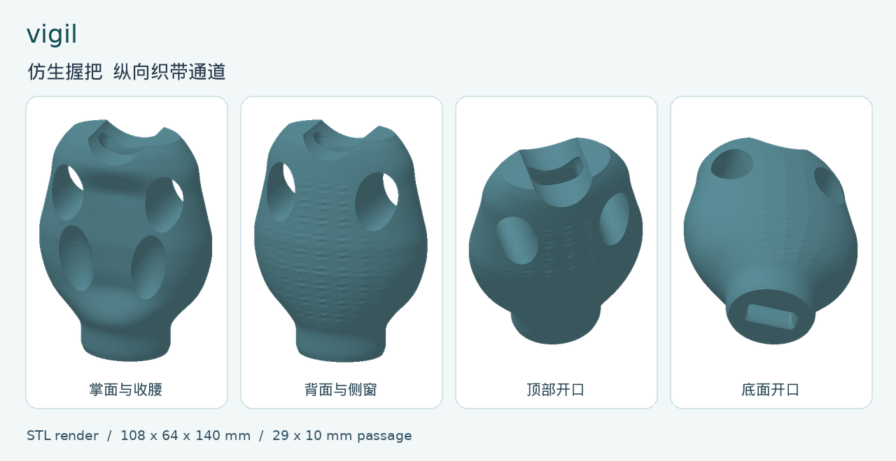

# vigil

[中文](vigil.md)

A wrist-training grip development model. The outer shape uses photographs as the reference. The first aim is to resist an external pull that opens the hand during wrist flexion and finger containment. The design status is awaiting a physical test.



## Shape and interface

- Overall envelope 108 × 64 × 140 mm. The first version's shoulders, palm swell, palm hollow, side windows, back texture, and tapered waist are kept. The side-window center is 105 mm from the bottom.
- The longitudinal channel runs from the top recess through to the bottom face. The narrowest section is 29 × 10 mm, with a 2 mm fillet in plan. Both ends flare, up to 33 × 14 mm.
- The interface assumption is finished load-bearing webbing 25 mm wide, with a total thickness of at most 6 mm at the pass-through, stitching included. Measure the real webbing first. The resistance band of 26 to 40 mm discussed earlier attaches outside the grip.
- The previous version widened the bottom from about 52 mm to 92 mm, added 20 mm to the overall height, and also moved the side windows down. This version restores the original surface and opens the channel from the inside and from the end faces. The dimensions come from the photographs and the first model, and they need a real in-hand check.

## Strap path and training load

Following the side-section sketch in the drawings, one end of the webbing runs from the bottom face to the top. The outer return comes back along the back. The two ends close through a connector compatible with the finished webbing, and the resistance band attaches outside. A complete assembly should pass the pull into the grip. The outer return and the connector need to leave room for the fingers and the thumb. Confirm that the connector can carry load as its manufacturer describes, that the webbing can pass the ports, and that the opening and the seam do not damage the face of the webbing.

Taking the real wrist axis as the reference, the moment is set by the pull and by the perpendicular distance from the line of action to that axis. In a wrist-flexion setup the external force has to produce an extension moment at the wrist. In a finger-containment setup the external force has to tend to open the fingers. After every change of anchor, check the direction and the moment arm again. Pronation, wrist raise, and side press need their own check.

## Printing and validation

1. The printer model, material grade, nozzle, wall lines, infill, and the intended maximum pull are set by the actual machine and the training conditions. Import the STL in millimetres. The upright orientation puts the longitudinal channel along the print Z axis. Check the tops of the side windows, the channel, and the port mouths, and arrange support that can be removed.
2. Unloaded, check the feel in the hand and the fit of the webbing. Measure the band width, the stitched thickness, and the opening size. With the real grip of the left hand and the right hand, check the clearance between the side-window edges, the outer return, the connector, and the fingers.
3. On a fixture, test the complete assembly along the real pull direction. Record the pull, the direction, the hold time, the number of loads, and the deformation. The responsible teacher at the school sets the test load and the pass criteria from the actual conditions of use. Watch beside the side windows, at the openings, and at the waist for cracks, separation between layers, permanent deformation, or wear of the webbing.
4. Set the training range from the physical results of that assembly. The geometry review and the numerical channel check are done. Data for the printed part, the assembly, the load, and fatigue are still to be added.

Geometry check record: one closed mesh, overall envelope 108 × 64 × 140 mm. The outer edge of each of 140 cross-sections sampled along the height matches the first version. Fifty-five longitudinal check lines inside the 25 × 6 mm rectangle pass through. About 5.5 mm beside the side window is the sampled radial margin, and a physical load test needs to watch it in particular.

## Files

In the repository root, `vigil.scad` is the parametric source, `vigil.stl` is the main model, `vigil.png` is the model preview, and `vigil.pdf` is the drawing set.

To re-export the main model, open `vigil.scad`, render, and export STL, or run the following command.

```sh
openscad --hardwarnings --export-format binstl -o vigil.stl vigil.scad
```

The geometry check for the whole repository runs from the repository root. The script re-exports every model with the CGAL backend, then checks the envelope, that the passage goes through, and the volume and bounding box against the committed STL:

```sh
./scripts/check.sh
```

Adjust the channel with `webbing_width` and `webbing_stack`. After a change, recheck the margin beside the side windows. With `axial_passage` off, the outer shape of the first version can be viewed. While the channel is on, the source limits the grip-body and side-window base dimensions, so the gap between them can be reviewed.

References: [Print orientation and structural parts](https://help.prusa3d.com/article/modeling-with-3d-printing-in-mind_164135) · [Checking and connecting a resistance band](https://abuhb.nhs.wales/files/patient-information-leaflets1/physiotherapy/safety-advice-when-exercising-with-resistance-bands-or-tubing-piu1332/)

## Finger-flexor grips with a band slot

Folders 03 through 09 have a side-to-side slot through the back, near the grip. The long side of the slot follows the grip height. The clear size is 44 × 8 mm, flaring at both ends. The design input is a resistance band 26 to 40 mm wide, with a total thickness of at most 6 mm at the pass-through. Measure a folded band as the stacked thickness, and measure a thicker end on its own. The original top recess, palm face, and bottom features stay. The overall envelopes match the previous models.

The shapes for 03 through 09 are in `finger_flexor.scad` at the repository root. The `vigil.scad` in each folder only names the variant. The folder number is 2 ahead of the old preset name: 03 corresponds to `grip_01`, through 09 as `grip_07`. Cylindrical sleeve 02 follows the drawings. Its source is not in this set of finger-flexor grips.

The band enters on one side and leaves on the other. Fasten it in a way the band manufacturer allows, and check whether the exposed run of band presses on the gripping fingers or rubs at the opening. The original blind seats in the bottom and the shallow grooves on the back remain as features of the shape. Before printing, check bridging or support at the crown of the transverse hole in the slicer, and confirm that support inside the hole can be cleared from both ends. Before the first use, validate the complete assembly with a load on a fixture.

In the finger-flexor source, `band_passage` turns the passage structure on or off. `band_width` and `band_stack` are the band width and the total thickness at the pass-through. With the passage enabled, each variant uses its default envelope. After a size change, recheck the passage and the material that remains.

[中文](vigil.md)
