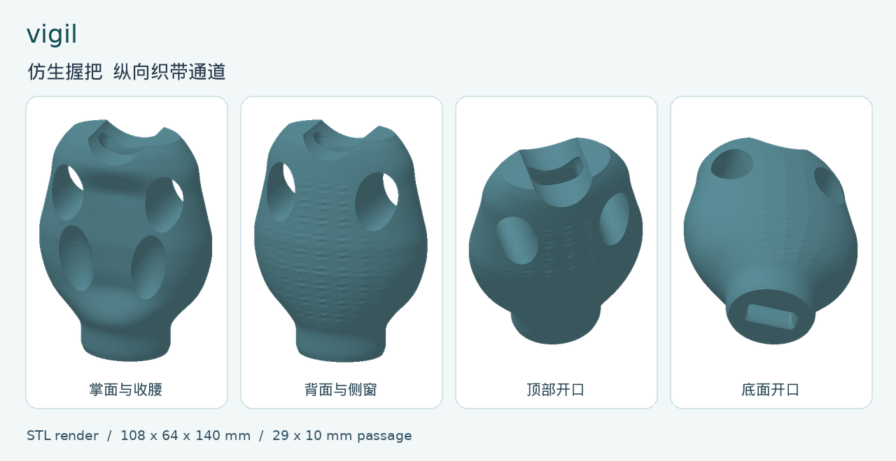

# vigil

以照片为外形参考的腕力训练握把开发模型。首要目标是屈腕与手指包握时抵抗外拉打开，设计状态为待实物验证。



## 造型与接口

- 外包络 108 × 64 × 140 mm。保留初版的双肩、掌腹、掌凹、侧窗、背部纹理和收腰。侧窗中心距底 105 mm。
- 纵向通道从顶部凹口通到底面。最窄截面 29 × 10 mm，平面圆角 R2。两端渐扩，扩张上限为 33 × 14 mm。
- 接口假设为 25 mm 宽的成品承力织带，穿孔部分含缝合处总厚不超过 6 mm。先测实物。原先讨论的 26 至 40 mm 弹力带接在外部。
- 上一版把底端从约 52 mm 加宽到 92 mm，整高增加 20 mm，还下移了侧窗。本版恢复原有曲面，从内部和端面开通道。尺寸来自照片和初版模型，需用实物试握核对。

## 走带和训练受力

按图纸的侧剖示意，织带一端从底面穿到顶部。外侧回程沿背侧返回，两端通过与成品织带相容的连接件闭合，再在外部接弹力带。完整装配应将拉力传给握把，外回程和接头要给手指与拇指留空间。确认连接件能按制造商说明受力、织带能穿过端口、孔口和接缝不会损伤带面。

以实际手腕转轴为基准，力矩大小由拉力与作用线到转轴的垂直距离共同决定。屈腕布置的外力要产生伸腕方向的力矩。包指布置要让外力产生打开握指的趋势。每次调整锚点后重新确认方向和力臂。旋前、提腕和侧压的受力另行验证。

## 打印与验证

1. 打印机型号、材料牌号、喷嘴、壁线、填充及预定最大拉力由实际设备和训练条件确定。以 mm 导入 STL。直立方向使纵向通道沿打印 Z 轴，检查侧窗顶部、孔道和端口收口，并安排可移除的支撑。
2. 空载检查手感和织带配合。量带宽、缝合厚度、开口尺寸。用实际左右手握姿检查侧窗边缘、外回程、接头与手指之间的间隙。
3. 在夹具上按实际拉力方向检验完整装配，记录拉力、方向、保持时间、加载次数及变形。由学校负责老师根据实际使用条件设定试验载荷和通过标准。观察侧窗旁、孔口和腰部是否有裂纹、层间开裂、永久变形或织带磨损。
4. 依据该装配的实物结果确定训练范围。当前已完成几何复核和数值通道检查，实物打印、装配、载荷与疲劳数据待补充。

几何检查记录：单个闭合网格，外包络 108 × 64 × 140 mm。140 个高度采样截面的外缘尺寸与初版一致。25 × 6 mm 矩形范围内的 55 条纵向检查线贯通。侧窗旁约 5.5 mm 是采样截面径向余量，需在实物受力验证中特别观察。

## 文件

根目录的 vigil.scad 为参数代码，vigil.stl 为主模型，vigil.png 为模型预览，vigil.pdf 为图纸。

重新导出主模型：打开 vigil.scad，渲染后导出 STL，或运行下列命令。

```sh
openscad --hardwarnings --export-format binstl -o vigil.stl vigil.scad
```

通过 webbing_width 与 webbing_stack 调整通道，改动后重检侧窗旁余量。axial_passage 关闭时可查看初版外形。代码限制开启通道时的握身和侧窗基础尺寸，便于复核两者之间的间隔。

参考：[打印方向与结构件设计](https://help.prusa3d.com/article/modeling-with-3d-printing-in-mind_164135) · [弹力带检查与连接注意事项](https://abuhb.nhs.wales/files/patient-information-leaflets1/physiotherapy/safety-advice-when-exercising-with-resistance-bands-or-tubing-piu1332/)

## 指屈把手穿带版

03 至 09 在背部靠近握身处开设左右贯通槽。槽的长边沿把手高度，净尺寸为 44 × 8 mm，两端渐扩。设计输入是弹力带宽 26 至 40 mm、穿孔部分总厚度不超过 6 mm。折叠的带子量叠在一起的总厚度，端头较厚时单独测量。原有顶部凹口、掌面和底部外形特征保留。外包络与此前模型一致。

弹力带从一侧穿入、另一侧出来。按弹力带制造商允许的连接方式固定，检查外露带段是否压到握指或在孔口磨擦。原底部盲窝和背部浅槽继续作为外形特征。打印前在切片器检查横孔顶部桥接或支撑，确认孔内支撑能从两端清理。首次使用前按完整装配做夹具加载验证。

指屈把手代码的 band_passage 可开关穿带结构，band_width 和 band_stack 对应带宽和穿孔总厚。启用穿带结构时使用各款默认外包络，改尺寸后需重查孔道和剩余材料。
